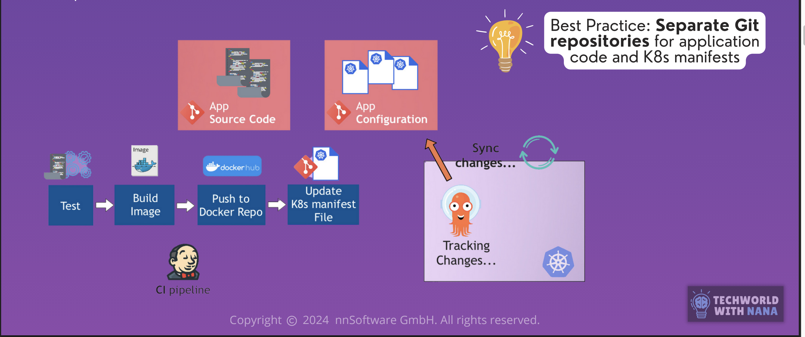
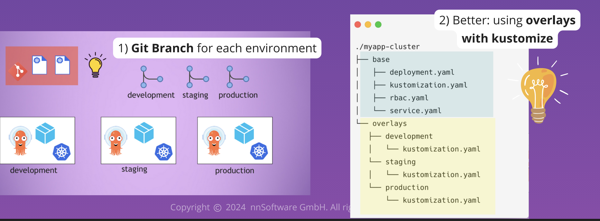
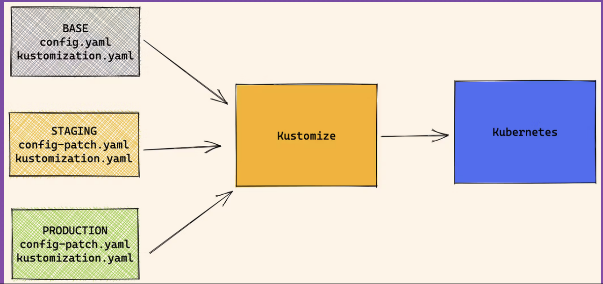
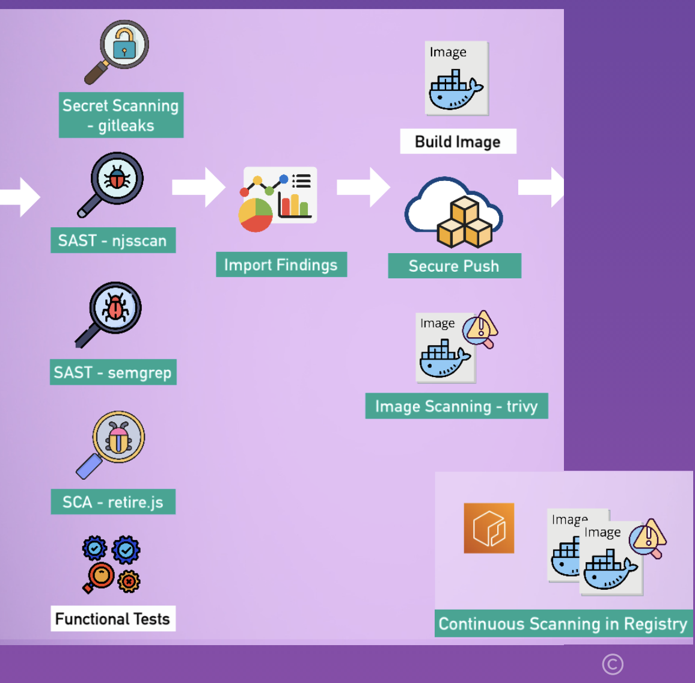
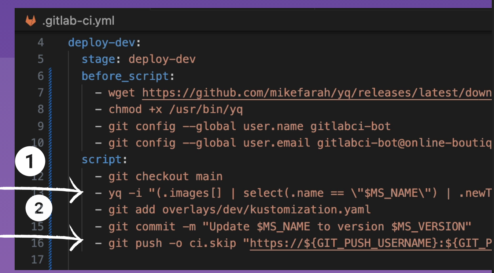
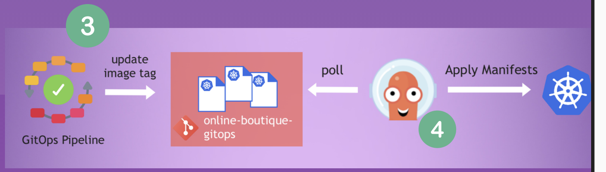
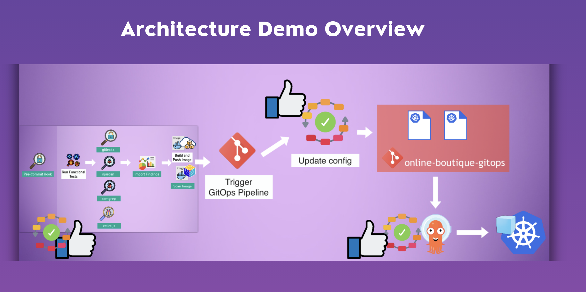

## What is Argo CD?

Argo CD is a Continuous Delivery tool for Kubernetes that automates the deployment of applications to Kubernetes clusters.

- A declerative GitOps tool for Kubernetes specifically
- It automates the deployment of applications to Kubernetes clusters in the specified environment
- It continuously monitors the deployed applications and ensures they are in sync with the desired state defined in Git

1. Argo CD is deployed in the K8s cluster and configured to track Git repository that hosts K8s manifests.
2. Argo CD agent monitors the Git repo (desired state) and compares it with the actual Kubernetes state of the applications deployed in the cluster.
3. If there is a drift between the desired state in Git and the actual state in the cluster, Argo CD can automatically or manually sync the cluster to match the desired state.
**Pull-Based Deployment:** instead of pushing application into K8s, Argo CD pulls the desired state from the Git repository and applies it to the cluster.

### Splitting CI and CD

- With own CD workflow introduced, you end up decoupling the build and release processes, allowing for more controlled and automated deployments to different environments.
- 


### Argo CD is Kubernetes native

- Argo CD extends the K8s API with Custom Resource Definition (CRD)
- It uses existing Kubernetes functionalities:
    - Using etcd to store data
    - Using K8s controllers to monitor and compare actual and desired state

**Real-time visibility and health status in the cluster.**

### Working with multiple K8s clusters

- 1 Argo CD is able to manage and sync multiple K8s clusters

2 Options to achieve: 1 Git repository and distinguish between deployment environments using Kustomize overlays, or multiple Git repositories for different environments.



### How Kustomize Works

**Overlays:** You define a base set of K8s manifests and then create environment-specific overlays on top of the base manifests to customize them for different environments.

**Kustomization.yaml File:**
    - It's a K8s CRD
    - In the yaml file you define the base resources and the configuration for the overlays, such as patches, environment-specific values etc.



---

## Set up Automated End-to-End pipeline with GitOps principles

1. IaC Repository(IaC pipeline) -- to define and manage the infrastructure resources.
2. Application Repository(CI pipeline) -- to define and manage the application code.
3. GitOps Repository(CD pipeline) -- hosting K8s manifests

I deployed Argo CD using IaC pipeline. See the configuration: https://gitlab.com/dominikjaro789/devsecops-infra-automation-eks/-/blob/feature/4-argocd-gitops-dom/online-boutique-argo-app.yaml?ref_type=heads

```yaml
apiVersion: argoproj.io/v1alpha1
kind: Application
metadata:
  name: online-boutique
  namespace: argocd
spec:
  project: default
  destination:
    server: https://kubernetes.default.svc
    namespace: default
  source:
    repoURL: https://gitlab.com/twn-devsecops-bootcamp/latest/online-boutique-gitops.git ## GitOps repository URL
    path: overlays/dev ## Path to the Kustomize overlay for the dev environment
    targetRevision: main
  syncPolicy:
    automated:
      prune: true ## Automatically delete resources that are no longer defined in Git
      selfHeal: true ## Automatically revert any changes in the cluster that deviate from the desired state in Git
    syncOptions:
    - CreateNamespace=true ## Automatically create the target namespace if it doesn't exist
```

Also, had to create a kubernetes secret -- Argo needs to authenticate with the Git repository to fetch the manifests.

## 2. Create CI pipeline for Application 

**CI Pipeline should include:**

- Various functional tests from unit tests to integration tests
- Various security scans, secret scanning and 3rd-party scans
- Continuous image scanning



## 3. Create CD pipeline for GitOps Repository

This pipeline is triggered by the CI pipeline.
It hosts the K8s yaml files that define the desired state

**GitOps Pipeline:**

1. Takes the variables of the CI pipeline as an input and updates the K8s manifest files
2. Commits the pushes changes to the Git repo



## 4. Argo CD Syncs the Changes

Argo CD automatically deployes the changes from the GitOps repository to the Kubernetes cluster.



